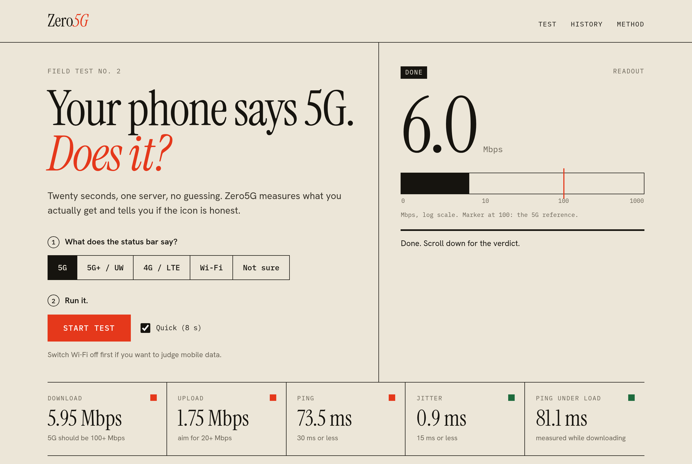
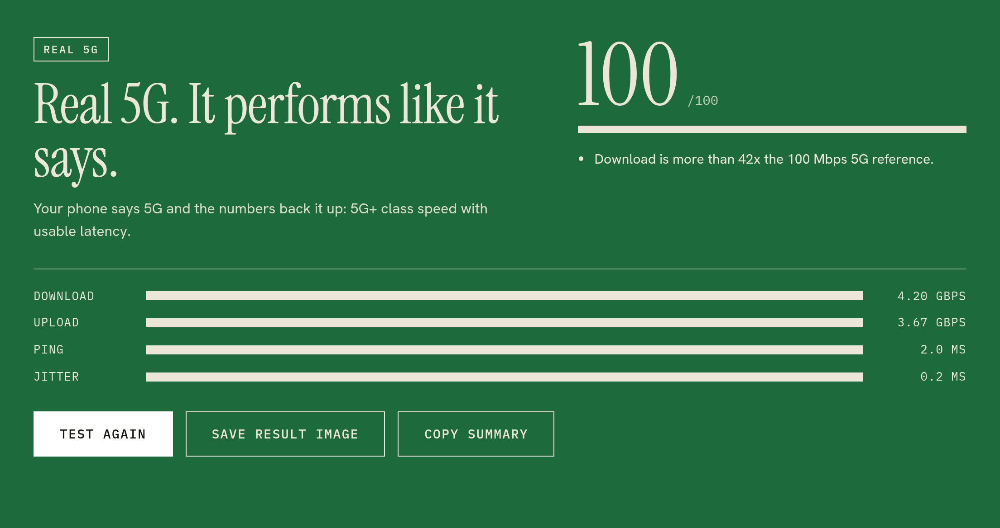
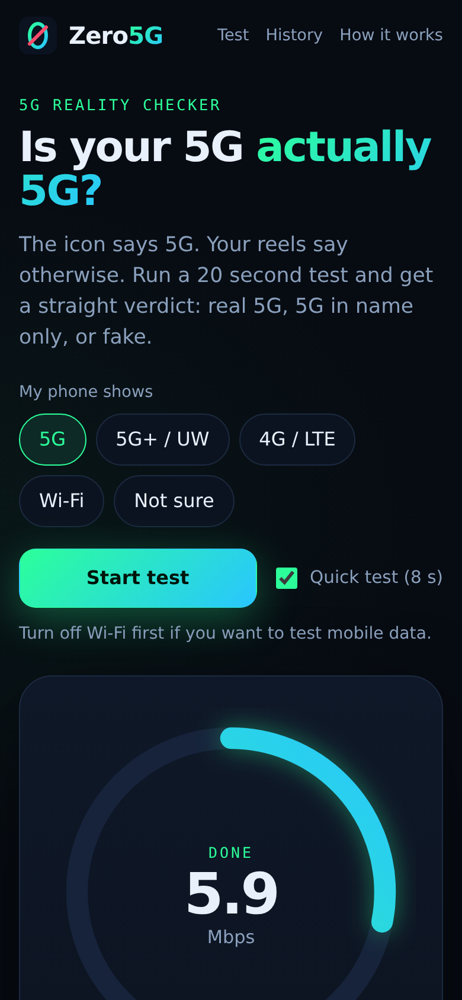

# Zero5G

**Is your 5G actually 5G?** A speed test suite with a 5G reality checker. Your phone shows a 5G icon, Zero5G measures what you really get and tells you if it is real 5G, 5G in name only, or fake.

Built for Tech Utsav.



## Features

- **Full speed suite:** download, upload, ping, jitter, and ping under load (bufferbloat).
- **5G checker:** pick what your phone shows (5G, 5G+/UW, 4G, Wi-Fi, not sure). Zero5G compares the label with the measured performance and returns **Real**, **Partial** or **Fake**, plus a 0-100 score and the reasons.
- **Live gauge and throughput chart** while the test runs. Stop at any time.
- **Shareable result image** (1080x1080 PNG) and copy-able text summary.
- **Local history** of your last 20 tests. Nothing leaves the device.
- Mobile first, keyboard accessible, no accounts, no trackers, no runtime dependencies.

| Real 5G | Fake 5G (mobile) |
|---|---|
|  |  |

## Run it

Needs Node 18 or newer.

```bash
git clone https://github.com/mananbharti/zero5g.git
cd zero5g
npm start            # http://localhost:3000
```

To test a phone, open `http://<your-computer-ip>:3000` on the same Wi-Fi, or deploy it (see below). Over plain `http` everything works; nothing here needs HTTPS.

Options: `PORT=8080 npm start`, `HOST=127.0.0.1`, `ZERO5G_SERVER_LABEL="Patiala"`.
Add `?quick=1` to the URL for the 8 second quick test.

### Deploy

It is one Node process with no build step. Any host that runs `npm start` works (Render, Railway, Fly, a VPS). Host it close to the people testing: the test measures the path to the server, so a far-away host lowers speed and raises ping.

## Tests

```bash
npm install          # only needed for the browser tests (puppeteer-core)
npm test             # 29 unit + server tests, no dependencies
npm run test:browser # 11 end-to-end checks in headless Chrome (set CHROME_PATH if needed)
npm run test:all
npm run screenshots  # regenerate docs/ images
```

The browser tests run real tests against a real server, including a throttled 6 Mbps / 70 ms link that must come back as **FAKE 5G**, cancel and error recovery, history, copy/share, mobile overflow and tap-target size, and a check that the page produces no console errors or CSP violations.

## How the verdict works

| Class | Download | Notes |
|---|---|---|
| 5G+ class | 300 Mbps and up | |
| Real 5G class | 100 Mbps and up | ITU IMT-2020 "user experienced" downlink target |
| Entry 5G / strong 4G | 40 to 100 Mbps | |
| 4G / LTE class | 10 to 40 Mbps | |
| 3G class | 2 to 10 Mbps | |
| 2G class | under 2 Mbps | |

A fast line with ping over 60 ms or jitter over 30 ms drops one class, because it will not feel like 5G.

Claiming 5G: Real/5G+ class is **Real**, entry class is **Partial**, anything lower is **Fake**.
Other claims (4G, Wi-Fi, not sure) get a plain speed report.

Score (0-100): download 45%, upload 15%, ping 25%, jitter 10%, ping under load 5%. Reference targets: 100 Mbps down, 20 Mbps up, 30 ms ping, 15 ms jitter.

These thresholds are practical heuristics, not an official certification. They are all in `public/js/verdict.js`.

## Honest limits

- A web page cannot read the radio type, so the 5G label comes from the user.
- Results depend on the server location, tower load, signal and plan limits.
- Run it a few times at different places and times.

## Layout

```
server.js            static files + /api/ping, /api/download, /api/upload (Node, no deps)
public/js/engine.js  measurement engine (parallel streams, loaded latency)
public/js/stats.js   pure maths (median, jitter, steady-state throughput)
public/js/verdict.js tiers, score, real/partial/fake judgement
public/js/app.js     UI wiring; chart.js, share.js, history.js
test/                unit, server and browser tests
```

MIT licensed.
